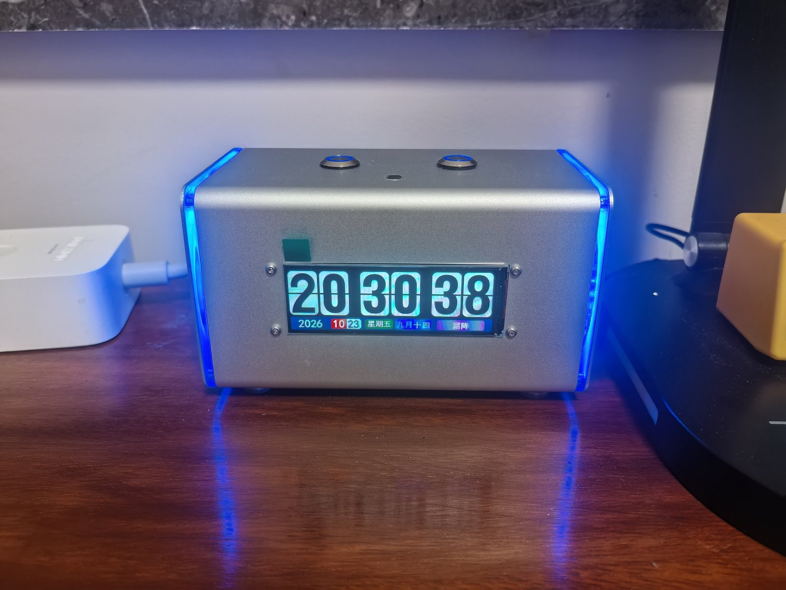

# ESP-ASR-Speaker · 翻页时钟 + 离线语音 + 蓝牙音箱

> 基于 **ESP32-WROVER-E (N16R8)** 与 **ASRPRO 2.0** 的桌面智能音箱：
> 王笑尘铝合金音箱外壳 + 81×26mm 彩色翻页时钟 + 离线语音识别 + HA TTS 播报 + 蓝牙 A2DP + 30 颗 WS2812 状态灯。
>
> 项目首发于『瀚思彼岸』论坛：[【阿木制作】集翻页时钟、离线语音、蓝牙音箱、TTS、WiFi 和彩灯音箱](https://bbs.hassbian.com/forum.php?mod=viewthread&tid=33323)



---

## 这个项目做了什么

一块自制的 ESP32 主板塞进现成的铝合金音箱壳里，把四件东西合成一台：

- **ESP32** 负责音频流、蓝牙接收、灯效状态机、IO 控制
- **ASRPRO** 专门做离线语音识别，识别结果通过 UART 发给 ESP32
- ESP32 再联动 **Home Assistant / Node-RED** 触发场景（说一句"关灯"，HA 执行 + TTS 回一句"好的，已为您关灯"）
- 不开 HA 也能当**普通蓝牙音箱**用

## 功能特性

| 功能 | 说明 |
|---|---|
| 离线语音输入 | ASRPRO 本地识别，不联网、隐私安全、响应快 |
| HA 语音播报 | ESPHome `media_player` 接入 HA Edge TTS 等服务，MP3 流式播放 |
| 蓝牙音箱模式 | `a2dp_sink` 组件，手机连上就放歌 |
| 翻页屏时钟 | 81×26mm 彩色翻页时钟，全时段在线显示 |
| 状态指示灯 | 30 颗 WS2812，用颜色 + 呼吸/渐变表达 9 种系统状态 |
| 物理按键 | 两颗面板键做短按/长按分层：灯带开关、亮度三档、静音、蓝牙切换 |
| 过热保护 | DS18B20 测箱内温度，>50℃ 橙色呼吸提示 |
| 电池供电 | 18650 + IP5306，Type-C 充电，拔电可用 |


🎬 效果视频：[docs/images/demo.mp4](docs/images/demo.mp4)

---

## 硬件设计

### 主要器件

| 模块 | 型号 | 作用 |
|---|---|---|
| 主控 | ESP32-WROVER-E **N16R8**（16MB Flash + 8MB PSRAM） | 音频调度、灯光、IO |
| 语音 | ASRPRO **2.0** 核心板 4M | 离线识别 + 本地 TTS |
| 功放 | MAX98357A（I2S 数字功放） | 4Ω10W 喇叭驱动 |
| 电源 | IP5306 升压充放电一体板（**需升级版常开模式，2A 以上**） | 5V 供电 + 电池充电 |
| 灯带 | WS2812 × 30（GRB） | 全系统状态指示 |
| 温度 | DS18B20 | 箱体过热保护 |
| 按键 | 12mm 带灯非自锁 ×2 + 自锁 ×1 | 灯光/亮度、静音/蓝牙、总电源 |
| 阻容 | 10kΩ ×2（按键上拉）、220Ω ×1（灯带串联）、470μF + 0.1μF（滤波） | 全直插，方便新手焊接 |

### 引脚分配

| 功能 | GPIO | 备注 |
|---|---|---|
| UART TX / RX（ASRPRO） | 14 / 13 | 115200 8N1 |
| I2S BCLK / LRCK / DOUT | 27 / 26 / 25 | MAX98357A |
| MAX98357 `SD_MODE` | 22 | 低电平 = 硬件静音 |
| WS2812 数据 | 19 | 串联 220Ω 到灯带 DIN |
| DS18B20 | 32 | 单总线，4.7K 上拉 |
| LED 键 | 34 | **必须外部 10k 上拉** |
| Mode 键 | 35 | **必须外部 10k 上拉** |

### 外壳与结构件

外壳、翻页时钟屏、WS2812 灯带都来自网上现成的 **王笑尘音箱**套件，本项目只重做了内部主板：

- 铝合金箱体 **70×70×120mm**，带透光板、透光喇叭托环、透光振膜
- 彩色翻页时钟屏 **81×26mm**
- 哈曼 4Ω10W 全频喇叭
- 18650 电池包、止震贴、配重块

> 结构件图纸（STL）后续单独放出；壳体属第三方商品，本项目不附带其图纸与商品图。

### PCB 状态

- 板框 **84 × 53 mm**，**2 层板**，全直插 + 拔插式核心板（方便升级）
- 原理图已通过 ERC；**布线尚未完成、GND 未铺铜，暂不提供 Gerber**，请勿直接打样
- ⚠️ 1.0 版打样板**两个开关的原理图画错了**，当时飞线解决；2.0 版板已在嘉立创下单，验证后再放工程图

用 **KiCad 10** 打开 `hardware/ESP-ASR-Speaker.kicad_pro`。

| 原理图 | PCB 预览 |
|---|---|
| [docs/schematic.pdf](docs/schematic.pdf) |  |

---

## 固件（ESPHome）

### 音频管线：单管线 + 双音源

为了把 HA TTS 和蓝牙音频塞进同一套音频栈，用 `speaker_source` 平台，把蓝牙音源与 HTTP 音源放进**同一条管线**：

```yaml
media_player:
  - platform: speaker_source
    media_pipeline:
      speaker: max98357_speaker
      sources: [ a2dp_source, http_source ]
      format: MP3
```

> 试过双管线混音，底层音频流格式必然冲突（`Incompatible audio streams`），最终改成单管线双媒体源；HA 侧强制转码 MP3 单声道。

### LED 状态对照

| 颜色 | 状态 |
|---|---|
| 白色闪烁 | 上电开机动画（亮度压到 45%，避开电源输出上限） |
| 绿色常亮 | 空闲待机 |
| 青色呼吸 | 正在拾音 LISTEN（3 秒无新指令自动回待机） |
| 彩虹渐变 | TTS 播报中 |
| 蓝色呼吸 | 蓝牙音箱模式 |
| 紫红常亮 | 已静音 |
| 橙色呼吸 | 箱内温度 > 50℃ |
| 红色**呼吸** | OTA 升级中 |
| 红色**常亮** | WiFi 掉线 |

当前优先级：**灯带关闭 > 静音 > 过热 > 蓝牙 > TTS 播报 > 待机**

### 按键

| 操作 | LED 键（GPIO34） | Mode 键（GPIO35） |
|---|---|---|
| 短按 | 开/关灯带 | 硬件静音开/关（拉低 SD_MODE） |
| 长按 ≥0.8s | 亮度循环 100% → 50% → 25% | 蓝牙模式开/关 |

### 部署

```bash
cd firmware
cp secrets.yaml.example secrets.yaml   # 填 WiFi / API 密钥
esphome run esp-asr-speaker.yaml
```

首次烧录用 USB（板型 `esp32-wrover-kit`，esp-idf 框架，PSRAM quad 80MHz），之后走 OTA。

外部组件（首次编译自动从 GitHub 拉取）：

```yaml
external_components:
  - source: github://MexHigh/ESPHome-UART-Read-Line-Sensor   # 串口按行收指令
  - source: github://PxPert/a2dp_sink@master                 # 蓝牙 A2DP 接收
```

---

## ⚠️ 避坑指南（照着做能少烧几块板）

**1. 王笑尘灯带的线色是反的**

> 红 = **GND**，黄 = **+5V**，黑 = **DATA**

不是"红正黑负"。我第一次没查卖家说明、只问了 AI，结果**烧了灯带和带灯开关**（灯带剪掉两颗还能用，开关报废）。接线前务必量一下。

**2. GPIO34 / 35 没有内部上拉**

必须外接 10kΩ 到 3.3V，悬空会乱触发。反过来，**不要**在按键两端并 0.1μF 电容——ESPHome 的 `delayed_on: 30ms` 软件消抖足够，硬件电容反而干扰。

**3. 灯带数据线串 220Ω**

GPIO19 与灯带 DIN 之间串 220~470Ω，防止信号反射烧掉第一颗灯珠。还要确保 ESP32 与灯带**共地**。

**4. 电源别小马拉大车**

功放遇到鼓点瞬间压降会让 ESP32 直接重启。IP5306 2.4A 已经是下限，条件允许上 3A/5A 升降压模块。
MAX98357A 的 VIN–GND 就近并 **470μF 以上**电解电容，灯带供电端并 **100μF 以上**。

**5. 蓝牙断开后重连不上**

`http_request: verify_ssl: false`，并且不要在代码里反复调 `stop()`，直接用 switch 实体控制蓝牙开关。

**6. TTS 没声音**

先查 HA 的 ffmpeg 是否正常，再把 `audio_http` 的 `buffer_size` 降下来。

**7. `minimum_chip_revision: "3.1"`**

按手上这块 WROVER 的批次写死的，换芯片批次先删掉这行，否则拒刷。日志默认 `WARN`，首刷排查时临时改 `INFO`。

---

## 目录结构

```
├─ hardware/                  KiCad 工程（原理图 / PCB / 工程配置）
├─ firmware/
│  ├─ esp-asr-speaker.yaml    ESPHome 主配置
│  ├─ secrets.yaml.example    密钥模板
│  └─ components/             自定义头文件（串口指令解析 / LED 状态机）
├─ docs/
│  ├─ schematic.pdf           原理图导出
│  ├─ pcb-top.svg             PCB 预览
│  ├─ bom.csv                 元件清单（不含价格）
│  └─ images/                 成品图与演示视频
├─ LICENSE
└─ README.md
```

## 物料清单

元件清单见 [docs/bom.csv](docs/bom.csv)（型号 / 封装 / 数量，不含采购价格）。
结构件另需：70×70×120 铝合金壳体、81×26mm 翻页时钟屏、哈曼 4Ω10W 喇叭、透光振膜与托环、18650 电池、止震贴、配重块。

## 已知问题 / Roadmap

- [x] 原理图 ERC 清零、35 个元件封装分配完毕
- [ ] **完成 PCB 布线 + GND 铺铜，出 Gerber**（当前不提供打样文件）
- [ ] 2.0 版板卡验证（1.0 版两个开关原理图画错，靠飞线救回）
- [ ] 结构件 STL 图纸整理后放出
- [ ] 补 `use_address`，解决 OTA mDNS 解析问题
- [ ] 第二台复刻验证（芯片批次、按键手感）

## 致谢

- 外壳与结构件：**王笑尘音箱**套件
- [MexHigh/ESPHome-UART-Read-Line-Sensor](https://github.com/MexHigh/ESPHome-UART-Read-Line-Sensor)
- [PxPert/a2dp_sink](https://github.com/PxPert/a2dp_sink)
- ESPHome / KiCad / 瀚思彼岸社区

## 免责声明

DIY 锂电池供电设备存在**短路起火风险**，请在接线无误、绝缘良好的前提下通电测试。作者不对任何复制过程中的损失负责。

## License

[MIT](LICENSE) © 2026 lambilly

> 固件与硬件设计文件同用 MIT。第三方件（ASRPRO 语音模型、翻页时钟模块、王笑尘外壳）遵循其各自的授权。
